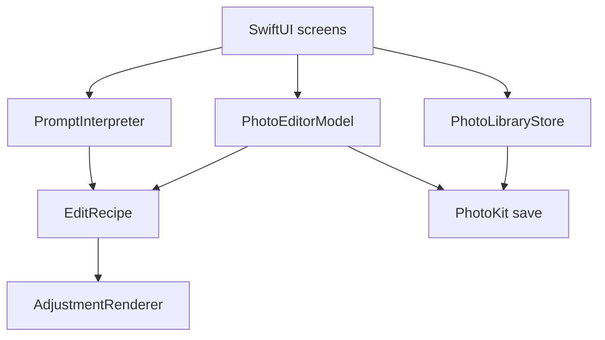

# PixelSense

PixelSense is an iPhone app that adjusts the color and tone of a photo already in Apple Photos.

It is a CS 152 project at San José State University, Fall 2026. The first check-in is October 20.

## Overview

You pick a still photo, change exposure, contrast, saturation, and warmth, and can save that look back to the same library item. A short sentence can fill those same sliders. The app does not generate a new picture or move objects. Apple Photos keeps its own original and edited versions.

## Features

Working in the current code:

- Browse still photos you allow the app to see
- Adjust exposure, contrast, saturation, and warmth
- Compare before and after
- Reset the sliders
- Type a supported sentence and tap Apply
- Save a JPEG and the adjustment recipe onto the selected photo

The save path and the prompt screen have not been checked on a physical iPhone yet. Logic tests cover the recipe and the sentence rules.

Not in the app yet: named presets, region-specific edits, and a Photos editing extension.

## Tech Stack

| Piece | Used for |
| --- | --- |
| Swift | App and prompt rules |
| SwiftUI | Screens |
| PhotoKit | Library access and save |
| Core Image | Color and tone |
| XCTest | Test target, not yet run in Xcode here |
| Swift command-line compiler | 32 logic tests for the recipe and prompts |

There are no third-party packages. Photos stay on the phone.

## Architecture



The prompt interpreter only returns recipe numbers. Rendering and saving stay on the existing path. Region masks are planned and are not in this diagram.

## Project Structure

```text
PixelSense/
├── App/          PixelSenseApp.swift
├── Editor/       screen, editor state, recipe, prompts, rendering
├── Photos/       library access and PhotoKit recipe storage
├── Info.plist
PixelSenseTests/  recipe and prompt checks
docs/             design, plan, handoff, check-in notes
```

## Getting Started

1. Clone the repo and open `PixelSense.xcodeproj` in Xcode 15.4 or later.
2. Select the PixelSense target. Under Signing & Capabilities, choose your Apple Account's Personal Team.
3. Run it on an iPhone with iOS 17 or later. Allow access to the photos you want to edit.
4. Pick a still photo, move the sliders or tap Apply, then tap Save to this photo.
5. In Photos, check that the same item changed and that no second photo was added.

A free Personal Team install expires after seven days. Use a photo set aside for testing until save and revert have been tried on a device.

The logic tests do not need the iOS app. From the repo root:

```bash
swiftc -parse-as-library -D LOGIC_TEST_RUNNER -o /tmp/pixelsense-logic-tests \
  PixelSense/Editor/EditRecipe.swift \
  PixelSense/Editor/PromptInterpreter.swift \
  PixelSenseTests/LogicChecks.swift \
  PixelSenseTests/LogicTestMain.swift
/tmp/pixelsense-logic-tests
```

On a Mac with Xcode selected, the shared PixelSense scheme also has a `PixelSenseTests` target. That target has not been run here because this machine only has Command Line Tools.

## Current Progress

Done in code: library browsing, four controls, before/after, reset, rule-based prompts, and a save request for the same Photos item.

Checked here: 32 logic tests for prompts and recipes. The full iOS app has not been rebuilt in this cleanup, and no iPhone run is recorded.

Still to do: device check of save, reopen, and revert; presets; region edits.

## Contributors

- Yug More — [Yug-More](https://github.com/Yug-More)
- Tejas — [Tejasvid29](https://github.com/Tejasvid29)

## Documentation

- [Architecture](docs/ARCHITECTURE.md) — how the pieces fit together
- [Project plan](docs/PROJECT_PLAN.md) — milestones and who owns what
- [Handoff](docs/HANDOFF.md) — what was done, what was tested, what is left
- [First check-in](docs/FIRST_CHECKIN.md) — notes for the October 20 presentation
