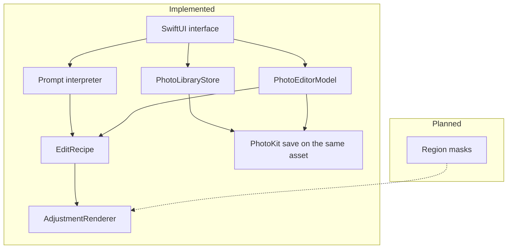
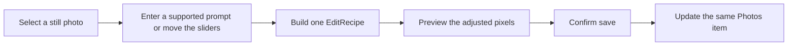

# PixelSense

PixelSense is a native iPhone editor that changes the color and tone of a photo already in Apple Photos.

Users adjust exposure, contrast, saturation, and warmth, preview the result, and save it back to the same library item. A rule-based prompt will eventually fill those same controls. The app does not generate a new scene, move objects, or change geometry.

- **Course:** CS 152 — Programming Paradigms, San José State University, Fall 2026
- **Instructor:** Dr. Saptarshi Sengupta
- **First check-in:** October 20, 2026

## Product overview

PixelSense is for someone who wants a clearer or warmer photo without learning a full editing suite. The user picks a still photo they already have, changes a small set of color and tone settings, and keeps the result on that same Photos item.

The adjustment is stored as a versioned recipe, separate from the rendered image. Apple Photos keeps its own original and edited renditions. PixelSense cannot overwrite the library file in place, and it does not promise that an edit uses no extra storage.

## Problem

Manual color controls are precise, but the first choice of settings is slow when a person only knows the look they want in words. PixelSense keeps the controls, and will translate a short supported phrase into those controls so the person can review them before saving.

The check-in version selects a photo, edits four controls by slider or by a rule-based prompt, previews the result, and can ask Photos to save it. Region masks and presets are still later work.

## Key features

| Feature | Status |
| --- | --- |
| Choose an authorized still photo from the library | Implemented |
| Preview exposure, contrast, saturation, and warmth | Implemented |
| Compare the unadjusted and adjusted preview | Implemented |
| Reset sliders to the neutral recipe | Implemented |
| Save a JPEG rendition and recipe onto the same Photos item | Implemented in code; not verified on a physical iPhone |
| Reopen a PixelSense recipe and continue editing it | Implemented in code; not verified on a physical iPhone |
| Rule-based prompt that fills the same recipe | Implemented in code; the editor screen has not been exercised on an iPhone |
| Named presets | Planned |
| Region-specific adjustments | Planned; design only until a later milestone |
| Launch from the Photos app as an editing extension | Deferred |

## Current development status

The current tree has the SwiftUI library browser, four global controls, a deterministic prompt field, and a unit-test target. There is no segmentation. The prompt rules were exercised by a macOS logic runner. The iOS app itself has not been rebuilt in this session, and no physical iPhone run is recorded.

As of October 12, 2026, generic iOS Simulator and generic iPhone builds were reported with code signing disabled. That result does not show that Photos save-back works on hardware. No physical iPhone run is recorded.

Device screenshots are pending. After a real-device pass, captures belong in `docs/assets/`. This repository does not include product images.

Details and acceptance checks are in the [project plan](docs/PROJECT_PLAN.md). Session notes are in the [handoff](docs/HANDOFF.md). Component boundaries are in the [architecture](docs/ARCHITECTURE.md).

## Technology stack

| Layer | Choice |
| --- | --- |
| Language | Swift 5 |
| Interface | SwiftUI |
| Photos access and save | PhotoKit |
| Color and tone | Core Image |
| Recipe storage | Versioned JSON in `PHAdjustmentData` |
| Minimum system | iOS 17, iPhone |
| Distribution for class | Xcode with a free Apple Account Personal Team |
| Services | None. Photos stay on the device. |

The Xcode project has no third-party packages.

## System architecture

Solid boxes are in the current tree. The dashed box is planned and is not in the build.



The prompt interpreter only produces an `EditRecipe`. It does not render pixels and it does not call a model. Region masks, when added, will only choose where the existing renderer applies settings.

## How PixelSense works

1. The user allows read/write or limited Photos access and selects a still photo. Live Photos are skipped.
2. The editor loads a PhotoKit content-editing input and shows the photo.
3. The user moves the sliders or taps **Apply** on a supported sentence. Either path updates one `EditRecipe`. A sentence replaces only the controls it names. The same recipe drives the preview and the full-size save.
4. An unsupported or contradictory sentence shows an explanation and leaves the sliders where they were. **Apply** does not save.
5. The user compares **Show before** and **Show edit**, changes sliders if needed, then taps **Save to this photo**.
6. PixelSense writes a JPEG rendition and the recipe, then commits that output on the selected asset. The save path does not create a new asset.



## Installation and setup

1. Install Xcode 15.4 or later. The deployment target is iOS 17.
2. Clone this repository and open `PixelSense.xcodeproj`.
3. Select the PixelSense target. Under **Signing & Capabilities**, choose the Personal Team for your own Apple Account.
4. Connect an iPhone running iOS 17 or later. If Xcode does not support that iOS version, update Xcode before running.
5. A free Personal Team install expires after seven days. Rebuild and reinstall after it expires. App Store and TestFlight distribution are outside the class prototype.

## Running the app

1. Build and run PixelSense on the connected iPhone.
2. Allow access to the photos you intend to edit.
3. Select a standard still photo. The browser shows up to 100 recent stills and excludes Live Photos.
4. Move exposure, contrast, saturation, or warmth, or enter a sentence such as "Make this photo warmer." and tap **Apply**. Use **Show before** and **Show edit** to compare.
5. Adjust the sliders again if you want, then tap **Save to this photo**.
6. In the Photos app, confirm that the same library item shows the edit and that no second gallery item appeared.

Use a photo set aside for testing until save, reopen, and revert behavior have been checked on a device. The app does not upload the photo.

## Testing

`PixelSenseTests` is an XCTest target with the shared `PixelSense` scheme. On a Mac with Xcode selected, run it with **Product > Test** or:

```bash
xcodebuild test -scheme PixelSense -destination 'platform=iOS Simulator,name=iPhone 15'
```

This development Mac has Command Line Tools only, so that command was not run. The same checks also compile as a small macOS program because `EditRecipe` and `PromptInterpreter` do not import SwiftUI or PhotoKit:

```bash
swiftc -parse-as-library -D LOGIC_TEST_RUNNER -o /tmp/pixelsense-logic-tests \
  PixelSense/EditRecipe.swift PixelSense/PromptInterpreter.swift \
  PixelSenseTests/LogicChecks.swift PixelSenseTests/LogicTestMain.swift
/tmp/pixelsense-logic-tests
```

On October 13, 2026 that runner printed `Passed 32 logic tests`. Those tests cover the prompt rules and recipe encoding. They do not launch the app or talk to Photos. `swiftc -parse` accepted the Swift sources. That parse does not prove the iOS target links.

What still needs a physical iPhone:

- Save updates one visible library item.
- Cancel or a failed save leaves the photo unchanged.
- A saved PixelSense edit reopens with the stored slider values.
- Photos revert behavior, orientation, metadata, JPEG appearance, iCloud downloads, and large photos.

A simulator build cannot establish those results.

## Programming paradigms

The course asks the project to use more than one paradigm where it fits the work.

**Object-oriented.** `PhotoLibraryStore` and `PhotoEditorModel` own library access, editor state, and the PhotoKit save request. The views observe those objects and do not perform the edit themselves.

**Functional.** `EditRecipe` is a value. `AdjustmentRenderer.apply` takes a recipe and a `CIImage` and returns another image. The preview and the save call that same function.

**Rule-based.** `PromptInterpreter` matches a small phrase list, applies an intensity, and either returns a recipe or an error. Recognizing the words is separate from deciding the slider values. It is not an AI model. Region rules are a later milestone.

## Development roadmap

| Milestone | Intent | Check-in position |
| --- | --- | --- |
| M0 Planning | Scope, platform, and ownership | Partial. Docs exist; device versions are still open |
| M1 Photos | Authorized selection and same-asset save | Code on `main`; physical-device acceptance is open |
| M2 Adjustments | One recipe for preview and save | Four controls plus bounds checks; device appearance is still open |
| M3 Prompts | Local phrases and presets mapped to that recipe | Phrase rules and the prompt field are in this tree; presets are not |
| M4 Regions | Masks that limit where settings apply | Design only for the check-in |
| M5 Demo polish | A full class demonstration | After the check-in |
| M6 Extension | The same editor inside Photos | Optional, after M1–M5 |

## Known limitations

- Only standard still photos are in scope. Live Photos, RAW, HDR, and video are deferred.
- The library browser lists at most 100 recent supported photos.
- Warmth is a fixed Core Image temperature shift. Its visual strength has not been judged on a device.
- Finite recipe numbers outside the slider ranges are clamped when decoded. Non-finite numbers become neutral. The prompt parser rejects a bad sentence instead of applying part of it.
- An edit made by another app is a baseline PixelSense does not try to reverse-engineer.
- The prompt vocabulary is small. Presets and region masks are not available. The prompt screen has not been tried on an iPhone.
- Photos may download an iCloud original during editing. That network use is PhotoKit's, not an upload to a PixelSense server.
- The logic runner passed 32 tests here. The XCTest bundle has not been launched, because Xcode is not selected on this Mac.

## Team and contributions

**Yug Amol More** (GitHub: [Yug-More](https://github.com/Yug-More)) — repository owner, check-in documentation, prompt rules, and the prompt field.

**Tejas** (GitHub: [Tejasvid29](https://github.com/Tejasvid29)) — project plan, iPhone prototype, and physical-device verification of the Photos save path.

The two students are the only GitHub collaborators. Session notes, including assisted work, are recorded in [docs/HANDOFF.md](docs/HANDOFF.md). Commits stay on the student accounts that make them.

## License and course use

PixelSense is a university project. Do not commit personal photos, signing certificates, or provisioning profiles.
