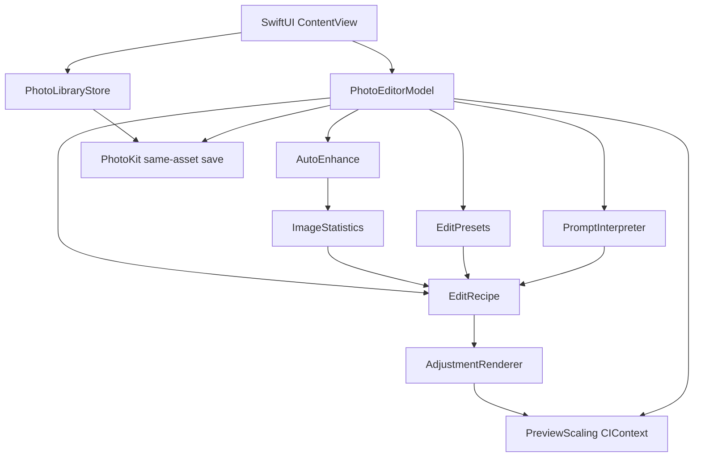

# PixelSense

PixelSense is a native iPhone photo editor for **color and tone**. It adjusts exposure, contrast, saturation, and warmth on a photo that already lives in Apple Photos, then can save that look back onto the **same library item**—without generating new scenes, moving objects, or creating a second gallery photo in the normal flow.

**Course:** CS 152 — Programming Paradigms, Fall 2026 · San José State University · Dr. Saptarshi Sengupta  
**Team:** [Yug More](https://github.com/Yug-More) · [Tejas](https://github.com/Tejasvid29)  
**Check-in:** October 22, 2026

---

## Overview

People often know what they want—“a little brighter,” “warmer,” “more colorful”—long before they want to invent a new picture. PixelSense focuses on that problem: reversible, explainable adjustments on an existing still photo.

You authorize Photos access, pick a recent still image, refine it with sliders, a short typed instruction, a named preset, or automatic enhancement, compare before and after, and optionally save. Apple Photos keeps its own original and edited versions; PixelSense stores a compact, versioned **edit recipe** alongside the rendered JPEG so edits can be reopened and refined.

The first class prototype is local to the iPhone. It does not require a paid Apple Developer Program membership, a cloud account, a server, or image upload.

---

## Features

| Feature | In code | Verified |
| --- | --- | --- |
| Manual exposure / contrast / saturation / warmth sliders | Yes | Logic limits tested; UI not device-verified |
| Natural-language instructions (deterministic rules) | Yes | Logic-tested |
| Automatic enhancement from image statistics | Yes | Logic-tested; visual quality not device-verified |
| Smart presets (Natural, Portrait, Vibrant, Warm, Cinematic) | Yes | Logic-tested |
| Before / after comparison | Yes | Not device-verified |
| Reset to neutral adjustments | Yes | Logic-tested |
| Photo library browse (still photos, limited/authorized access) | Yes | Not device-verified |
| Non-destructive same-asset save (JPEG + `PHAdjustmentData`) | Yes | **Not accepted** — no physical iPhone result yet |
| Reopen saved PixelSense recipes | Yes (code path) | Not device-verified |
| Region edits / Photos editing extension | No | Out of scope for check-in |

“Logic-tested” means the Swift CLI runner documented below. A simulator-only build does **not** prove Photos save-back works on hardware.

---

## Example Workflow

Intended journey (code supports these steps; end-to-end Photos save is not hardware-verified yet):

1. Allow PixelSense to access the photos you choose.
2. Select a still photo from the grid.
3. Type an instruction such as `Make this photo brighter and warmer.` and tap **Apply instruction**.
4. Optionally tap **Auto enhance** or choose a preset such as **Vibrant**.
5. Drag sliders to refine; use **Show before** / **Show edit** to compare.
6. Tap **Save to this photo** when you want Photos to update that same item.

Unsupported requests (for example removing a person) show an error and leave the current recipe unchanged.

---

## Architecture

| Piece | Responsibility |
| --- | --- |
| **SwiftUI** (`ContentView`) | Permissions UI, photo grid, editor controls, prompt, presets, enhance |
| **PhotoLibraryStore** | Photos authorization and still-asset browsing |
| **PhotoEditorModel** | Session state, load/preview/save, prompt/preset/enhance application |
| **PromptInterpreter** | Deterministic phrase → `EditRecipe` (not a trained model) |
| **EditRecipe** | Versioned adjustment values and shared numeric limits |
| **EditPresets / AutoEnhance** | Named recipes and statistics-based recommendations |
| **AdjustmentRenderer** | Core Image transforms (exposure → warmth → color controls) |
| **PhotoKit** | Content editing input/output and same-asset commit |



Preview rendering uses a cached, downscaled source. Save always renders full resolution from a fresh Photos content-editing input. Region masks are planned later and are not in this diagram.

Programming paradigms used in the project:

- **Object-oriented** — `PhotoLibraryStore` and `PhotoEditorModel` own session state.
- **Functional** — `EditRecipe` is a value; `AdjustmentRenderer.apply` and `PromptInterpreter.interpret` are pure transforms.
- **Rule-based interpretation** — prompts and auto-enhance use documented rules, not generative AI.

---

## Technology Stack

| Technology | Role |
| --- | --- |
| Swift 5 / iOS 17+ | Application language and deployment target |
| SwiftUI | User interface |
| PhotoKit | Library access and non-destructive content edits |
| Core Image | Color and tone filters |
| XCTest | Xcode test target (when Xcode is available) |
| Swift command-line compiler | Headless logic tests without the iOS SDK |

No third-party packages. Photos stay on the device.

---

## Project Structure

```text
PixelSense/
├── App/
│   └── PixelSenseApp.swift
├── Editor/
│   ├── ContentView.swift
│   ├── PhotoEditorModel.swift
│   ├── EditRecipe.swift
│   ├── PromptInterpreter.swift
│   ├── EditPreset.swift
│   ├── AutoEnhance.swift
│   ├── ImageStatistics.swift
│   ├── ImageStatisticsSampler.swift
│   └── AdjustmentRenderer.swift      # includes PreviewScaling
├── Photos/
│   ├── PhotoLibraryStore.swift
│   └── EditRecipePhotoKit.swift
├── Info.plist
PixelSense.xcodeproj/
PixelSenseTests/
│   ├── LogicChecks.swift
│   ├── LogicTestMain.swift
│   └── PixelSenseLogicTests.swift
docs/
│   ├── ARCHITECTURE.md
│   ├── PROJECT_PLAN.md
│   ├── TEAM_WORK_PLAN.md
│   ├── HANDOFF.md
│   └── FIRST_CHECKIN.md
AGENTS.md
README.md
```

---

## Getting Started

### Required

- macOS with **Xcode 15.4 or later** (full Xcode app, not only Command Line Tools)
- An Apple ID for free Personal Team signing
- An iPhone on **iOS 17+** for Photos save testing (recommended)

### Optional

- iOS Simulator — useful for UI layout; **does not** establish Photos save-back acceptance
- Swift command-line tools alone — enough to run logic tests, not enough to build the iOS app

### Build and run

1. Clone the repository and open `PixelSense.xcodeproj` in Xcode.
2. Select the **PixelSense** scheme and your team under Signing & Capabilities (Personal Team is fine for class demos).
3. Run on a physical iPhone when testing Photos. Grant photo library access when prompted.
4. Prefer a still photo set aside for testing until save and revert have been tried.

Free Personal Team installs expire after about seven days and must be rebuilt.

---

## Testing

### CLI logic tests (available without the iOS SDK)

From the repository root:

```bash
swiftc -parse-as-library -D LOGIC_TEST_RUNNER -o /tmp/pixelsense-logic-tests \
  PixelSense/Editor/EditRecipe.swift \
  PixelSense/Editor/PromptInterpreter.swift \
  PixelSense/Editor/ImageStatistics.swift \
  PixelSense/Editor/AutoEnhance.swift \
  PixelSense/Editor/EditPreset.swift \
  PixelSense/Editor/AdjustmentRenderer.swift \
  PixelSenseTests/LogicChecks.swift \
  PixelSenseTests/LogicTestMain.swift
/tmp/pixelsense-logic-tests
```

**Latest result on the authoring machine:** `Passed 61 logic tests` (prompts, recipes, presets, auto-enhance rules, and renderer/preview scaling regressions).

### What each kind of test covers

| Kind | What it proves | What it does not prove |
| --- | --- | --- |
| CLI logic tests | Recipe math, prompt rules, enhance/preset logic, renderer clamp/identity/scale helpers | UI layout, PhotoKit, device performance |
| Xcode `PixelSenseTests` | Same logic under XCTest when Xcode can build the app | Photos library behavior |
| Simulator launch | App starts and UI can be exercised | Same-asset Photos save acceptance |
| Physical iPhone | Permissions, save, reopen, revert, real warmth appearance | — |

---

## Current Development Status

| Area | Status |
| --- | --- |
| Smart editing (prompt, presets, auto-enhance, editor UI) | Implemented; logic-tested; merged via PR #5 |
| Renderer reliability and preview caching | Implemented on Yug’s rendering branch; logic-tested |
| PhotoKit same-asset save / reopen / revert | Implemented in code; **awaiting Tejas device verification** |
| Region-aware edits | Design only |
| Photos editing extension | Out of scope for the class check-in |

---

## Roadmap

1. **Tejas:** Run the device checklist in [`docs/TEAM_WORK_PLAN.md`](docs/TEAM_WORK_PLAN.md) (TEJ-8), prioritize same-asset save (TEJ-4), then reopen/revert (TEJ-5/6).
2. **Yug:** Maintain renderer and smart-editing paths; fix issues Tejas files from visual/device review.
3. **Both:** October 22 presentation, Career-Connect materials, and event reflection (individual Canvas submissions).
4. **Later:** Region masks only after save behavior is believable on hardware.

---

## Team Contributions

| Person | GitHub | Engineering ownership |
| --- | --- | --- |
| Yug More | [Yug-More](https://github.com/Yug-More) | Prompt rules, presets, auto-enhance, editor smart tools, Core Image reliability, preview performance, related tests and docs |
| Tejas | [Tejasvid29](https://github.com/Tejasvid29) | PhotoKit authorization/browsing, selection/loading, save/reopen/revert verification, Xcode and physical-device integration |

Detailed task IDs and contracts: [`docs/TEAM_WORK_PLAN.md`](docs/TEAM_WORK_PLAN.md). Session notes: [`docs/HANDOFF.md`](docs/HANDOFF.md).

Assisted tooling work, when used, is recorded in the handoff. Commits stay on the student accounts. Do not commit personal photos, signing certificates, or provisioning profiles.

---

## Limitations

- Editing is **rule-based**, not generative AI. Unsupported sentences fail instead of inventing edits.
- Only global exposure, contrast, saturation, and warmth are supported (no crop/object removal as product features).
- Warmth uses a fixed Kelvin mapping that still needs a visual check on a real display.
- Preview downscales for responsiveness (longest side capped for interactive use); save uses full resolution.
- Photos save/reopen/revert have **not** been accepted on a physical iPhone yet.
- This README environment may only have Command Line Tools; full `xcodebuild` may be unavailable until Xcode is selected.

---

## Screenshots

_No application screenshots are checked into the repository yet. When available, add device captures here for the library grid, editor with prompt/presets, and before/after comparison. Do not commit personal photos._

---

## Documentation

- [Architecture](docs/ARCHITECTURE.md)
- [Project plan](docs/PROJECT_PLAN.md)
- [Team work plan](docs/TEAM_WORK_PLAN.md)
- [Handoff](docs/HANDOFF.md)
- [First check-in notes](docs/FIRST_CHECKIN.md)

---

## License

No license file is present in this repository. Treat the project as an academic coursework codebase unless the maintainers add an explicit license later.
