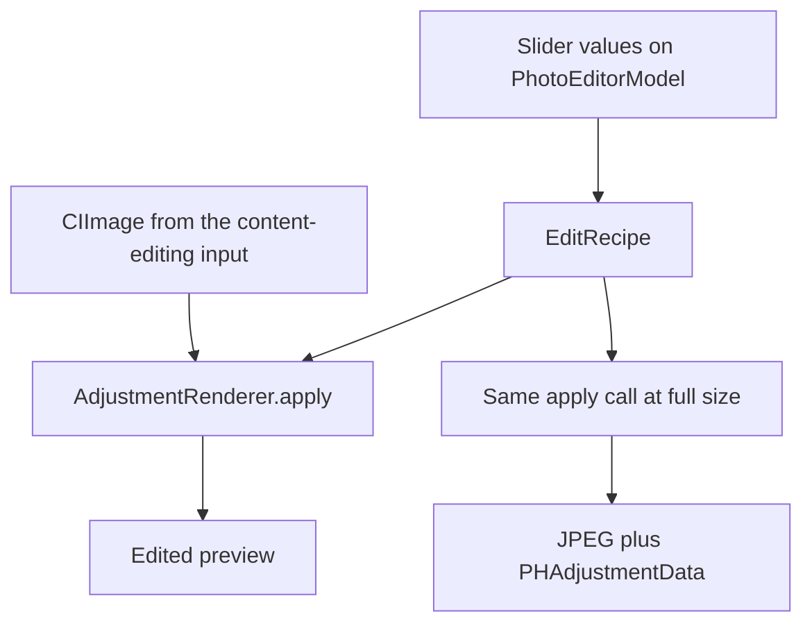
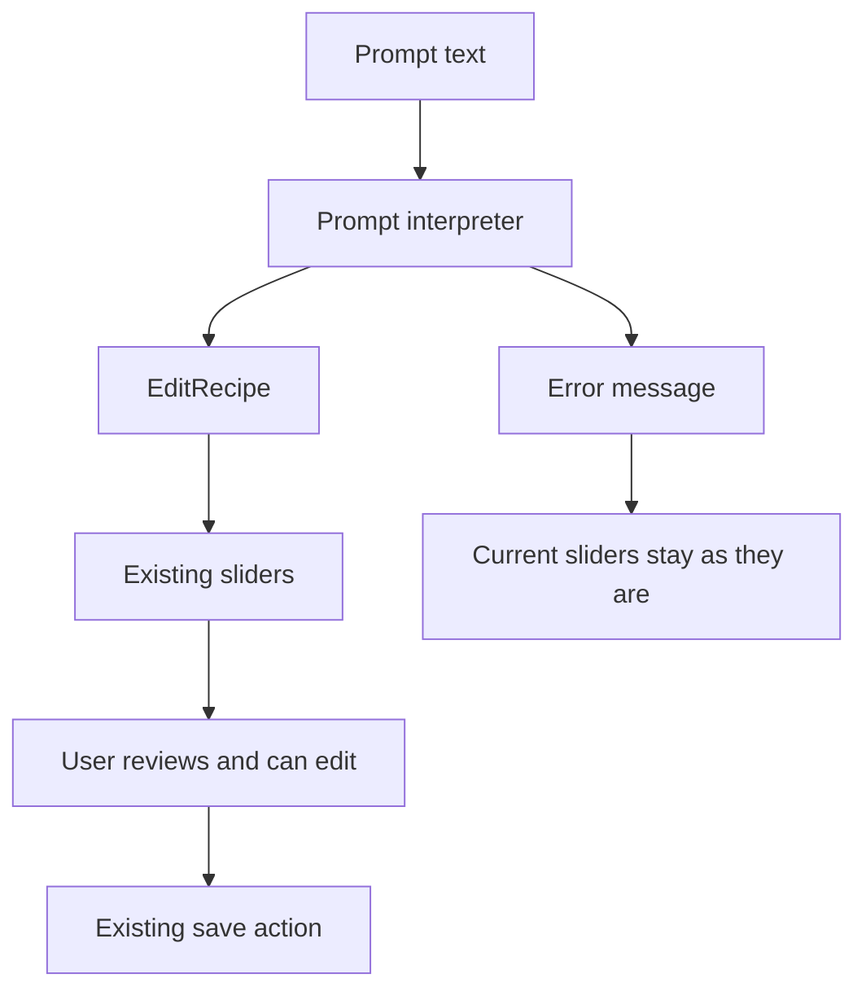
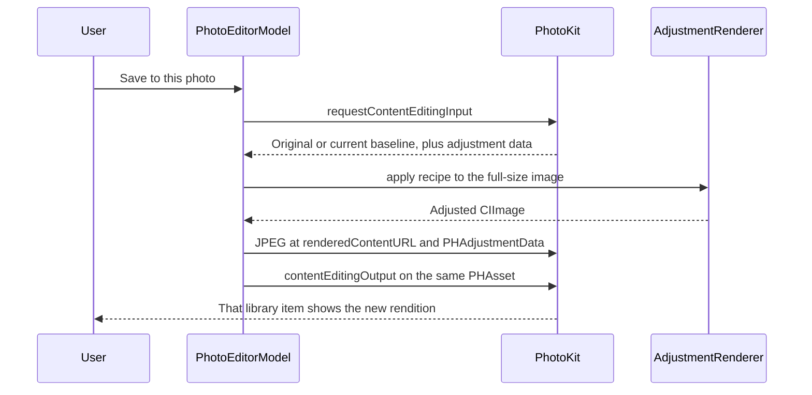

# PixelSense architecture

Last updated: 2026-10-13

This document describes the app as it exists on `main`, and the two additions planned around the October 20, 2026 check-in: a deterministic prompt interpreter, and a written design for later region masks. It does not add those features to the build.

## Layers

The app is a single iOS target. Processing stays on device. There is no backend, account, or image upload.

| Layer | Type | Responsibility |
| --- | --- | --- |
| Interface | SwiftUI views in `ContentView.swift` | Permission prompt, photo grid, editor controls, save button, and error text |
| Library | `PhotoLibraryStore` | Read/write or limited Photos authorization, and a list of recent still images |
| Editor | `PhotoEditorModel` | Load one asset, hold slider state, render previews, and submit a content edit |
| Recipe | `EditRecipe` | Versioned adjustment values shared by preview and save |
| Rendering | `AdjustmentRenderer` | Core Image transforms from a recipe and an image to a new image |
| Prompt interpretation | Planned Swift type | Map a supported sentence to a recipe, or return an error |
| Region targeting | Planned, after global edits are reliable | Build a mask that selects where the renderer applies a recipe |

`PixelSenseApp` only creates a window with `ContentView`.

## Components on `main`

### PhotoLibraryStore

Requests `PHPhotoLibrary` authorization for `.readWrite`. Access is treated as present for `.authorized` and `.limited`. Denied or restricted access leads the interface to Settings. The store loads image assets, skips Live Photos, stops at 100 photos, and sorts by creation date, newest first.

### PhotoEditorModel

Owns the selected `PHAsset` and the four published adjustment values. `load` requests a `PHContentEditingInput`. If the adjustment data is a PixelSense recipe of format `edu.sjsu.pixelsense.recipe` version `1`, those values fill the sliders. Otherwise the sliders start at zero and the image Photos supplied is the baseline.

`canHandleAdjustmentData` returns true only when that recipe decodes. PhotoKit then provides the original image plus the PixelSense recipe, so a later save reapplies the full recipe instead of stacking a second edit. An unknown recipe is left untouched: PixelSense edits the rendition Photos provides and does not claim the other app's settings are editable.

`save` requests a fresh input, renders a full-size JPEG to `PHContentEditingOutput.renderedContentURL(for: .jpeg)`, attaches the encoded recipe as `PHAdjustmentData`, and assigns that output on `PHAssetChangeRequest` inside `PHPhotoLibrary.performChanges`. The closure does not insert a new asset.

### EditRecipe

A `Codable` value with `exposureEV`, `contrast`, `saturation`, and `warmth`. Missing keys decode as zero so an older exposure-only payload still reads. The format identifier and version live on the type.

The sliders currently enforce ranges: exposure −2…+2, contrast −0.5…+0.5, saturation −1…+1, warmth −1…+1. The struct does not clamp. A check-in test pass should lock those bounds in one place used by the sliders and the future parser.

### AdjustmentRenderer

`apply(_:to:)` is the only render path.

| Control | Neutral | Core Image filter | Mapping |
| --- | --- | --- | --- |
| Exposure | 0 | `CIExposureAdjust` | `ev` equals `exposureEV` |
| Warmth | 0 | `CITemperatureAndTint` | Neutral 6500K; target is `6500 - warmth * 2500` |
| Contrast | 0 | `CIColorControls` | Contrast is `1 + contrast` |
| Saturation | 0 | `CIColorControls` | Saturation is `1 + saturation` |

A neutral control is skipped. Warmth uses color temperature: a positive value moves the target below 6500K, which reads warmer; a negative value moves it above 6500K, which reads cooler. The scale is a fixed choice and still needs a visual check on hardware.

Preview rendering scales the longest side to at most 1400 points. Save renders the oriented full-size image to JPEG in sRGB. Both call `apply`.

### ContentView

`ContentView` shows the library. `PhotoEditorView` shows the preview, before/after toggle, four sliders, reset, and save. Thumbnail requests are cancelled when a cell disappears. There is no prompt field.

## Data flow

### Slider edit, implemented

Reset sets every value to zero and refreshes the preview. That zero recipe is the neutral adjustment on whatever baseline Photos supplied for this input.

### Prompt edit, planned

The interpreter will be a pure function from a string to either a recipe or a user-readable error. The editor will copy a successful recipe onto the existing sliders. The user can move the sliders afterward. Save stays the button that already exists.

Check-in rules, specified in [PROJECT_PLAN.md](PROJECT_PLAN.md) and not implemented:

- The parser understands warmth, exposure, contrast, and saturation only. Brightness words map to exposure.
- "Slightly", "a bit", and "a little" move 25 percent of the way from neutral to that control's limit. No intensity word moves 50 percent. "Much", "a lot", and "significantly" move to the limit.
- Different controls in one sentence combine.
- Opposite directions for one control produce an error and do not change the sliders.
- Two phrases in the same direction keep the stronger intensity.
- Values are clamped to the slider ranges.
- Region words, style names, and unknown phrases return an unsupported-prompt error.

## PhotoKit save workflow

Official behavior used here:

- [Editing asset content](https://developer.apple.com/documentation/photokit/editing-asset-content)
- [PHContentEditingOutput](https://developer.apple.com/documentation/photos/phcontenteditingoutput)
- [Core Image color adjustment filters](https://developer.apple.com/documentation/coreimage/color-adjustment-filters)

`renderedContentURL(for:)` requires iOS 17, which is the deployment target. JPEG is the first supported output. If the asset does not accept JPEG, save stops with an error.

This workflow updates one visible asset. Photos stores original and edited data internally. The app does not delete the user's original and does not claim a zero-storage overwrite.

## Error handling

`PhotoEditError` is the set of failures the editor shows in the interface:

| Case | When it is used |
| --- | --- |
| `noEditingInput` | PhotoKit returns no content-editing input |
| `noImageData` | The input has no readable full-size image |
| `unsupportedOutput` | JPEG is not a supported rendered type for the item |
| `renderingFailed` | Core Image cannot produce a preview bitmap |
| `savingFailed` | `performChanges` fails without a system error |

Authorization failures stay in the library screen: a request button while access is undetermined, and an Open Settings button when access is denied or restricted. A limited library shows only the photos the user allowed.

The save button is disabled while a load or save is in progress. There is no separate cancel control for an in-flight save. Thumbnail image requests are cancelled when the cell disappears. A content-editing request is not cancelled from the interface.

The planned parser adds a second error channel for language the rules do not support. That message must not be reported as a Photos failure.

## Programming paradigms

**Object-oriented.** Library access and the editing session are reference objects with a clear public surface: request access, refresh, load, update the preview, reset, and save. SwiftUI observes them. Adding a prompt field should call the editor; it should not embed PhotoKit calls in the view.

**Functional.** The recipe is a value, and rendering is a transformation. Tests can construct a recipe and check the result without a view. The renderer does not write slider state.

**Rule-based.** Prompt decisions will be explicit matches and a documented conflict rule, so a demo can show why a sentence became a set of numbers. A statistical model is not part of this design. The project plan allows a later review only if the agreed demo phrases cannot be handled by rules.

## Planned region integration

Milestone M4 is not in the check-in build. The intended shape, once global editing and device save are reliable:

1. Keep global `EditRecipe` fields as the default.
2. Add optional per-region overrides on a later recipe version. Version 1 readers must keep decoding today's four fields.
3. Use an on-device Vision segmentation request to build a mask for one case first, such as person versus background. Sky is a separate feasibility question, not an assumed filter.
4. Feed the mask to the existing Core Image graph so the override changes color and tone inside the mask. The mask does not replace pixels with new content and does not move edges.
5. Feather the mask boundary. If confidence is low, skip the override, tell the user, and keep the global recipe.
6. Store compact override values in `PHAdjustmentData`. Recompute the mask when the edit is reopened rather than embedding a full-size mask in the recipe.

Dependencies would be Apple's Vision and Core Image frameworks, still on device. The hard parts are mask edges, memory on large photos, recipe compatibility, and proving the result on team-owned sample photos. None of that starts until M1 and M3 are in better shape.

A Photos editing extension (`PHContentEditingController`) remains milestone M6. It would share `EditRecipe` and `AdjustmentRenderer` with the app. It is out of scope for October 20.

## What this architecture leaves out

The check-in does not add albums, search, manual curves, local retouch, generative edits, or a network API. Those would change the product boundary already recorded in the project plan.
