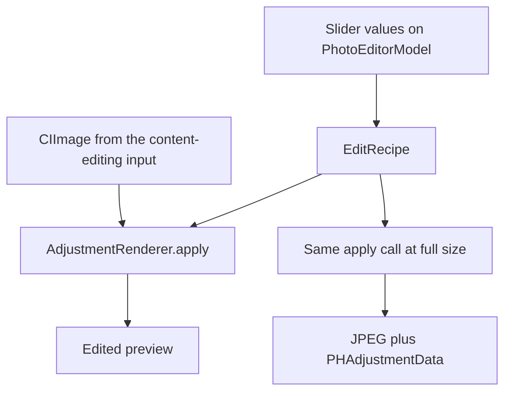
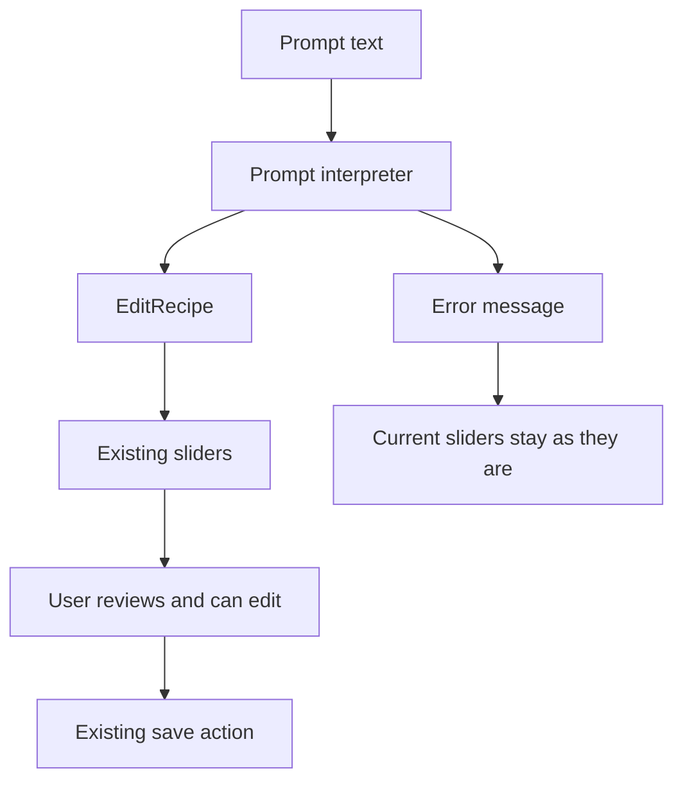
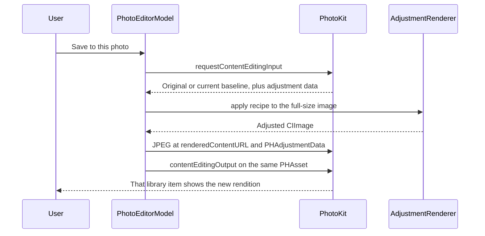

# PixelSense architecture

Last updated: 2026-10-13

This document describes the check-in tree: library selection, four global controls, a deterministic prompt interpreter, and the PhotoKit save path. Region masks are specified and not implemented. Physical-device save behavior is still unverified.

## Layers

The app is a single iOS target. Processing stays on device. There is no backend, account, or image upload.

| Layer | Type | Responsibility |
| --- | --- | --- |
| Interface | SwiftUI views in `ContentView.swift` | Permission prompt, photo grid, prompt field, sliders, save button, and error text |
| Library | `PhotoLibraryStore` | Read/write or limited Photos authorization, and a list of recent still images |
| Editor | `PhotoEditorModel` | Load one asset, hold slider state, apply a prompt, render previews, and submit a content edit |
| Recipe | `EditRecipe` | Versioned adjustment values and the shared numeric limits |
| Prompt | `PromptInterpreter` | Map a supported sentence to a recipe, or return an error |
| Rendering | `AdjustmentRenderer` | Core Image transforms from a recipe and an image to a new image |
| Region targeting | Planned, after global edits are reliable | Build a mask that selects where the renderer applies a recipe |

`PixelSenseApp` only creates a window with `ContentView`.

## Components on `main`

### PhotoLibraryStore

Requests `PHPhotoLibrary` authorization for `.readWrite`. Access is treated as present for `.authorized` and `.limited`. Denied or restricted access leads the interface to Settings. The store loads image assets, skips Live Photos, stops at 100 photos, and sorts by creation date, newest first.

### PhotoEditorModel

Owns the selected `PHAsset` and the four published adjustment values. `load` requests a `PHContentEditingInput`. If the adjustment data is a PixelSense recipe of format `edu.sjsu.pixelsense.recipe` version `1`, those values fill the sliders. Otherwise the sliders start at zero and the image Photos supplied is the baseline.

`canHandleAdjustmentData` returns true only when that recipe decodes. PhotoKit then provides the original image plus the PixelSense recipe, so a later save reapplies the full recipe instead of stacking a second edit. An unknown recipe is left untouched: PixelSense edits the rendition Photos provides and does not claim the other app's settings are editable.

`save` requests a fresh input, renders a full-size JPEG to `PHContentEditingOutput.renderedContentURL(for: .jpeg)`, attaches the encoded recipe as `PHAdjustmentData`, and assigns that output on `PHAssetChangeRequest` inside `PHPhotoLibrary.performChanges`. The closure does not insert a new asset. `applyPrompt` does not call `save`.

### EditRecipe

A `Codable` value with `exposureEV`, `contrast`, `saturation`, and `warmth`. Missing keys decode as zero so an older exposure-only payload still reads. The format identifier stays `edu.sjsu.pixelsense.recipe` and the format version stays `1`. PhotoKit encoding lives in `EditRecipePhotoKit.swift`, so the value type itself does not import Photos.

The limits live on the type and are shared by the sliders and the interpreter:

| Control | Minimum | Maximum |
| --- | ---: | ---: |
| Exposure | -2 | 2 |
| Contrast | -0.5 | 0.5 |
| Saturation | -1 | 1 |
| Warmth | -1 | 1 |

A finite value outside its range is clamped when the recipe is decoded or when `clamped()` runs. A non-finite value becomes 0. A successful prompt is clamped before it reaches the sliders. An invalid prompt is rejected and does not change the current recipe. In-range saved recipes decode to the same numbers as before.

### PromptInterpreter

`interpret(_:current:)` is a pure function. The stages are:

1. **Normalize.** Lowercase the text and turn punctuation into spaces.
2. **Reject blocked words.** Region words, style names such as "cinematic", and content edits such as remove, replace, blur, or generate fail the whole sentence.
3. **Match phrases.** Longer phrases win when two patterns overlap, so "warmth" is not read as the word "warm".
4. **Read strength in that clause.** "Slightly", "a bit", and "a little" use 25 percent of the distance from neutral to the control's limit. No strength word uses 50 percent. "Much", "a lot", "strongly", and "significantly" use 100 percent. Two different strengths in one clause are an error. A bare control joined by "and", such as "increase contrast and saturation", copies the previous clause's direction and strength, then uses its own limit.
5. **Detect conflicts.** Opposite directions for one control fail the whole sentence. The same direction keeps the stronger value.
6. **Build the recipe.** Mentioned controls are replaced with those absolute values. Unmentioned controls stay. The result is clamped.
7. **Return.** Success is a recipe. Failure is `PromptFailure` with a short message. Nothing is saved.

`PromptApplication` is the small state change the editor uses: `apply` updates the recipe only on success, and `reset` returns every control to zero. The view calls `PhotoEditorModel.applyPrompt`, which copies that result onto the sliders and refreshes the preview.

Syntax is the matched words. Semantics are the numbers those words write. "Increase brightness slightly" is recognized as an exposure increase at 25 percent, which means `exposureEV = 0.5` because the exposure limit is 2. The same 25 percent on warmth means `warmth = 0.25` because that limit is 1. The parser is not a compiler and not a model.

### AdjustmentRenderer

`apply(_:to:)` is the only render path.

| Control | Neutral | Core Image filter | Mapping |
| --- | --- | --- | --- |
| Exposure | 0 | `CIExposureAdjust` | `ev` equals `exposureEV` |
| Warmth | 0 | `CITemperatureAndTint` | Neutral 6500K; target is `6500 - warmth * 2500` |
| Contrast | 0 | `CIColorControls` | Contrast is `1 + contrast` |
| Saturation | 0 | `CIColorControls` | Saturation is `1 + saturation` |

A neutral control is skipped. Warmth uses color temperature: a positive value moves the target below 6500K, which reads warmer; a negative value moves it above 6500K, which reads cooler. The scale is a fixed choice and still needs a visual check on hardware.

Preview rendering scales the longest side to at most 1400 points. Save renders the oriented full-size image to JPEG in sRGB. Both call `apply`.

### ContentView

`ContentView` shows the library. `PhotoEditorView` shows the preview, before/after toggle, prompt field, four sliders, reset, and save. The contrast slider steps by 0.025 so the 25 percent contrast value, 0.125, lands on a detent. Thumbnail requests are cancelled when a cell disappears. The prompt field does not upload text.

## Data flow

### Slider edit, implemented

Reset sets every value to zero and refreshes the preview. That zero recipe is the neutral adjustment on whatever baseline Photos supplied for this input.

### Prompt edit

`PromptInterpreter.interpret` returns a recipe or a `PromptFailure`. On success, `PhotoEditorModel.applyPrompt` copies the recipe onto the sliders and refreshes the preview. On failure it sets `promptError` and leaves the sliders alone. The user can move the sliders afterward. Save stays the separate **Save to this photo** button.

The agreed sentences and values are in [PROJECT_PLAN.md](PROJECT_PLAN.md). Brightness language writes `exposureEV`. "Strongly" uses the same 100 percent tier as "much", "a lot", and "significantly".

## PhotoKit save workflow

Official behavior used here:

- [Editing asset content](https://developer.apple.com/documentation/photokit/editing-asset-content)
- [PHContentEditingOutput](https://developer.apple.com/documentation/photos/phcontenteditingoutput)
- [Core Image color adjustment filters](https://developer.apple.com/documentation/coreimage/color-adjustment-filters)

`renderedContentURL(for:)` requires iOS 17, which is the deployment target. JPEG is the first supported output. If the asset does not accept JPEG, save stops with an error.

This workflow updates one visible asset. Photos stores original and edited data internally. The app does not delete the user's original and does not claim a zero-storage overwrite.

## Error handling

`PhotoEditError` is the set of failures the editor shows in the interface:

| Case | When it is used |
| --- | --- |
| `noEditingInput` | PhotoKit returns no content-editing input |
| `noImageData` | The input has no readable full-size image |
| `unsupportedOutput` | JPEG is not a supported rendered type for the item |
| `renderingFailed` | Core Image cannot produce a preview bitmap |
| `savingFailed` | `performChanges` fails without a system error |

Authorization failures stay in the library screen: a request button while access is undetermined, and an Open Settings button when access is denied or restricted. A limited library shows only the photos the user allowed.

The save button is disabled while a load or save is in progress. There is no separate cancel control for an in-flight save. Thumbnail image requests are cancelled when the cell disappears. A content-editing request is not cancelled from the interface.

Prompt failures use `promptError`, separate from `errorMessage`. A sentence PixelSense does not understand is not reported as a Photos failure. **Apply** is disabled while the field is empty or while a load or save is in progress.

## Programming paradigms

**Object-oriented.** Library access and the editing session are reference objects. `PhotoLibraryStore` hides the fetch, and `PhotoEditorModel` hides loading, preview, prompt application, and save. SwiftUI observes them. The prompt field calls `applyPrompt`. It does not call PhotoKit.

**Functional.** The recipe is a value. `AdjustmentRenderer.apply` and `PromptInterpreter.interpret` take values in and return values out. They do not write slider state or start a save. `PromptApplication.apply` is the explicit state transition from a sentence to the next recipe.

**Rule-based, syntax, and semantics.** The match list is the syntax: which phrases are legal. The intensity table and the per-control limits are the semantics: what number a legal phrase writes. A conflict is a sentence that is syntactically recognizable and still has no meaning the editor will apply. A statistical model is not part of this design. The project plan allows a later review only if the agreed demo phrases cannot be handled by rules.

## Planned region integration

Milestone M4 is not in the check-in build. The intended shape, once global editing and device save are reliable:

1. Keep global `EditRecipe` fields as the default.
2. Add optional per-region overrides on a later recipe version. Version 1 readers must keep decoding today's four fields.
3. Use an on-device Vision segmentation request to build a mask for one case first, such as person versus background. Sky is a separate feasibility question, not an assumed filter.
4. Feed the mask to the existing Core Image graph so the override changes color and tone inside the mask. The mask does not replace pixels with new content and does not move edges.
5. Feather the mask boundary. If confidence is low, skip the override, tell the user, and keep the global recipe.
6. Store compact override values in `PHAdjustmentData`. Recompute the mask when the edit is reopened rather than embedding a full-size mask in the recipe.

Dependencies would be Apple's Vision and Core Image frameworks, still on device. The hard parts are mask edges, memory on large photos, recipe compatibility, and proving the result on team-owned sample photos. None of that starts until M1 and M3 are in better shape.

A Photos editing extension (`PHContentEditingController`) remains milestone M6. It would share `EditRecipe` and `AdjustmentRenderer` with the app. It is out of scope for October 20.

## What this architecture leaves out

The check-in does not add albums, search, manual curves, local retouch, generative edits, or a network API. Those would change the product boundary already recorded in the project plan.
