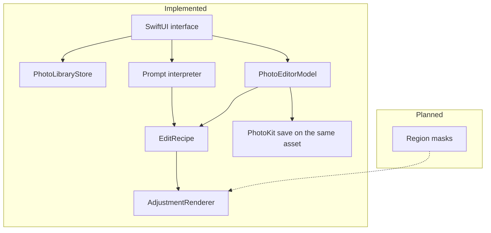

# PixelSense first check-in

October 20, 2026 · CS 152, San José State University

This note is for the class check-in. It describes the tree on `feature/first-checkin-prompt-editing`. It is not a claim that the app has been run on an iPhone.

## Project and objective

PixelSense is a native iPhone editor for color and tone. A student or any phone owner picks a still photo already in Apple Photos, changes exposure, contrast, saturation, and warmth, and can save that look back onto the same library item.

The course goal is to show object-oriented structure, functional transformations, and rule-based interpretation in one small product.

## Problem

People can say "make it warmer" more easily than they can choose a warmth number. A full editor also makes it easy to change the picture itself: crop, erase, or generate something new. PixelSense stays on the first problem and refuses the second.

## Solution

The app reads an authorized still photo, keeps one `EditRecipe`, and renders it with Core Image for both the preview and the save. A sentence either fills part of that recipe or shows an error. Sliders stay available after the sentence. Saving is a separate button and uses the existing PhotoKit content edit.

## Architecture

Details are in [ARCHITECTURE.md](ARCHITECTURE.md).

## Implemented features

| Feature | Evidence in this check-in |
| --- | --- |
| Browse authorized still photos, skip Live Photos, cap the list at 100 | Code in `Photos/PhotoLibraryStore.swift`. Not re-run on a device in this session. |
| Exposure, contrast, saturation, warmth, before/after, reset | Code on the editor. Logic tests cover neutral reset and the numeric limits. |
| Rule-based prompt and an Apply button | `Editor/PromptInterpreter.swift` and the editor field. 32 logic tests passed. The screen was not opened on an iPhone. |
| Save onto the same Photos asset | Existing `PhotoEditorModel.save`. Not modified in this sprint. No physical save result. |
| Region detection and presets | Not implemented. The region design is written down only. |

## Programming paradigms

**Object-oriented.** `PhotoLibraryStore` and `PhotoEditorModel` own library access and the editing session. The SwiftUI view displays state and forwards taps. It does not call PhotoKit itself.

**Functional.** `EditRecipe` is a value. `AdjustmentRenderer.apply` returns a new image. `PromptInterpreter.interpret` returns a new recipe or an error. Neither function saves a photo.

**Rule-based syntax and semantics.** Syntax is the phrase list: "warmer", "increase brightness", "reduce saturation", and the strength words. Semantics are the numbers. Strength is 25, 50, or 100 percent of the way from zero to that control's limit, so the same word "slightly" is 0.5 EV and only 0.25 warmth. A sentence that names both directions of one control is recognizable and still rejected. The parser is not a compiler, a logic-programming engine, or a machine-learning model.

## Technical decisions

- iOS 17, still photos, JPEG content edits, recipe format `edu.sjsu.pixelsense.recipe` version `1`.
- One recipe for preview and save. PhotoKit keeps the original rendition; the app does not overwrite the library file in place.
- Prompt values replace the controls they name. Other sliders stay put. Failure changes nothing.
- Finite out-of-range saved numbers are clamped on decode. Non-finite numbers become zero. Previously saved in-range recipes still decode to the same values.
- No third-party packages and no network API. Photos stay on the device.

## Demo scenarios

Use a still photo set aside for testing. Read the sentence, tap **Apply**, and show the sliders before tapping **Save to this photo**.

| Say this | Sliders that should change |
| --- | --- |
| Make this photo warmer. | Warmth +50%. Exposure, contrast, and saturation stay as they were. |
| Increase brightness slightly. | Exposure +0.5 EV. |
| Make the photo cooler and increase contrast. | Warmth −50% and contrast +25%. |

A fourth supported sentence, "Reduce saturation.", sets saturation to −50%. If the demo needs a failure, "Make it warmer and cooler." should show a conflict and leave the sliders unchanged. "Remove the person." should explain that PixelSense only changes the four controls.

## Short script

"PixelSense edits a photo we already have. It does not invent a new picture.

We start in the library and open one still photo. The sliders are exposure, contrast, saturation, and warmth. I can move them by hand.

I can also type 'Make this photo warmer' and tap Apply. The warmth slider moves to halfway. The other sliders stay put. The preview uses the same recipe we would save.

Next, 'Increase brightness slightly.' Brightness in this app means exposure, and slightly means a quarter of the way to the limit, which is plus 0.5 EV.

Then, 'Make the photo cooler and increase contrast.' That is one sentence with two controls: warmth down halfway, contrast up a quarter.

If I say warmer and cooler together, the app stops and changes nothing. If I ask it to remove a person, it refuses, because that is not a color adjustment.

I can still drag a slider after the sentence. Save is a separate button. It asks Photos to update this same item. We still need to show that last step on a phone; the automated tests cover the recipe, not the Photos library."

## Testing evidence

| Check | Result on October 13, 2026 |
| --- | --- |
| 32 prompt and recipe logic tests | Passed. Command and files are in the [README](../README.md) testing section. |
| `swiftc -parse` on the Swift sources | Passed. This does not link the iOS app. |
| `plutil -lint` on the Xcode project | Passed. |
| `xcodebuild test` | Not run. This Mac's developer directory is Command Line Tools. |
| Simulator launch | Not run. |
| Physical iPhone save, reopen, or revert | Not run. The last recorded device-less builds were the October 12 generic builds with signing disabled. |

## Challenges and limitations

- PhotoKit can update one visible item and still store an original rendition. We do not describe that as a zero-storage overwrite.
- The prompt list is intentionally small. Unknown words fail instead of being guessed.
- Warmth is a fixed temperature shift and has not been judged on a screen.
- The prompt layout is written for a scrolling iPhone editor and has not been looked at on a device.
- Xcode was not available here, so a compile of the full app is still a check we owe.

## Next milestones

1. Tejas runs selection, prompt, slider edit, and save on an iPhone and records what Photos does.
2. Fix whatever that run finds in the save path.
3. Leave region masks and the Photos extension until that save is believable. The mask design is already in the architecture note.

## Contributions

**Yug Amol More** (`Yug-More`) owns the repository, the check-in docs, the prompt rules, and the prompt field.

**Tejas** (`Tejasvid29`) owns the original editor and the physical-device save check.

Assisted work is recorded in [HANDOFF.md](HANDOFF.md). The students remain the only GitHub collaborators.
